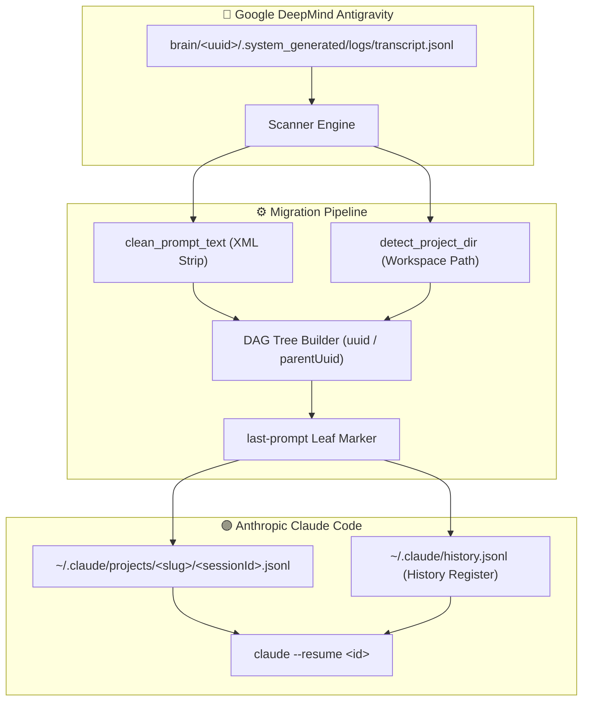

# 🏛️ Architecture & System Design

AntigravityToClaude, Google DeepMind Antigravity konuşma geçmişlerini Anthropic Claude Code DAG düğüm formatına ve dosya depolama mimarisine çeviren bir migrasyon katmanıdır.

---

## 📐 Veri Akışı ve Mimari Şema

---

## 🧩 Katmanlar ve Sorumluluklar (SRP)

1. **`src/scanner.py` (Keşif ve Ön İşleme)**:
   - `get_brain_dir()` ile platformlar arası `~/.gemini/antigravity/brain` dizinini bulur.
   - Her klasördeki `transcript.jsonl` dosyasını ayrıştırır.
   - `clean_prompt_text()` ile `<USER_REQUEST>`, `<ADDITIONAL_METADATA>` ve sistem bloklarını temizler.
   - `detect_project_dir()` ile araç çağrılarında (read/write/command) en sık geçen geçerli repo yolunu analiz ederek oturumun ait olduğu gerçek projeyi belirler.

2. **`src/converter.py` (Dönüştürme ve DAG Üretimi)**:
   - **Slugify Standartı**: `C:\Users\Halil Emre\Desktop\LifeOS` -> `C--Users-Halil-Emre-Desktop-LifeOS` (Claude Code konvansiyonu).
   - **DAG Hiyerarşisi**:
     - `user` mesajı: `parentUuid: null` veya önceki `assistant` UUID'si.
     - `assistant` mesajı: `parentUuid: user_uuid`, metin ve araç blokları.
     - `last-prompt`: Oturum sonundaki aktif yaprak düğümü (`leafUuid`).
   - **Kayıt**: Oturumu `projects/<slug>/<sessionId>.jsonl` dosyasına yazar ve `history.jsonl` kütüğüne ekler.

3. **`src/cli.py` (Kullanıcı Arayüzü & Tek Tık Konsolu)**:
   - Windows terminalinde UTF-8 ve ANSI renkleri etkinleştirir.
   - Çift tıklandığında otomatik tüm oturumları tarar, dönüştürür ve çıkışta kullanıcının inceleyebilmesi için pencereyi açık tutar.

---

## 🔒 Dokunulmaz Kurallar

1. **Kayıpsız Veri Koruma**: Orijinal Antigravity dosyalarına asla yazılmaz; sadece salt-okunur (`r`) taranır.
2. **Claude Code İzolasyonu**: `history.jsonl` güncellenirken mevcut Claude oturumları ezilmez; sadece yeni oturumlar `append` edilir.
3. **Fail-Safe Fallback**: Proje dizini tespit edilemeyen oturumlar için genel çalışma alanı atanır.
